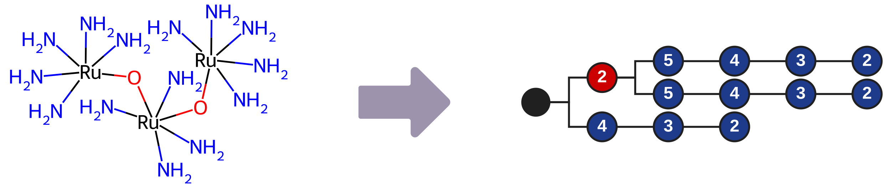

  

MolAlignLib
===========

A high-performance library to compute the minimum RMSD between two structures of the same atoms, finding the optimal atom matching and superposition at the same time.

MolAlignLib compares structures in two ways:

- **Molecular conformers** (`conformsd`). The bond graph is partitioned into a Hierarchical Neighborhood of Atoms (HNA), which restricts the search to topologically valid atom assignments. This gives the exact symmetry-corrected RMSD in milliseconds, even for highly symmetric molecules that are intractable by conventional graph-isomorphism approaches ([Vásquez-Pérez, 2026](https://doi.org/10.1021/acs.jctc.6c00545)).
- **Atom clusters** (`atormsd`). Without bond information, atoms are matched by element and position, using random orientations refined by alternating atom assignment and superposition. This suits metal clusters, nanoparticles and other systems where connectivity is absent or irrelevant ([Vásquez-Pérez et al., 2023](https://doi.org/10.1021/acs.jcim.2c01187)).

Both methods are available as command-line programs, as C functions in a static library, and from Python.

> [!IMPORTANT]
> **The [2.x branch](https://github.com/qcuaeh/molalignlib/tree/2.x) is a complete rewrite of the [1.x branch](https://github.com/qcuaeh/molalignlib/tree/1.x) and is not compatible with it:**
>
> The 1.x branch is still the repository's default, so a plain `git clone` or `pip install git+https://github.com/qcuaeh/molalignlib.git` gets 1.x. The command-line options, the bindings and the Python API have all changed, so scripts and code written for 1.x must be adapted. Both versions install a Python module named `molalignlib`, so installing one replaces the other.
>
> |  | 1.x | 2.x |
> |--|-----|-----|
> | Methods | Near-congruence algorithm for rigid molecules and clusters (2023) | The 2023 algorithm (`atormsd`) plus HNA partitioning for conformers (2026, `conformsd`) |
> | Programs | `molalign` | `atormsd` and `conformsd`, with new options |
> | C API | None | `ato_rmsd` and `confo_rmsd` (`molalign.h`) |
> | Python API | `assign_atoms` on ASE `Atoms` objects | `Molecule` class with `ato_rmsd` and `confo_rmsd` methods, files read with chemfiles |
> | Build | `build.sh` | CMake (programs and C library) or pip (Python) |
