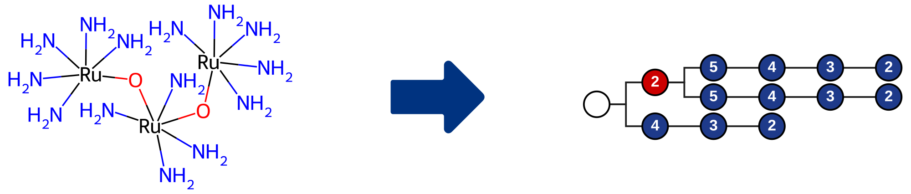

<p align="center">
  
</p>

MolAlignLib
===========

A high-performance library to compute symmetry-corrected RMSD between conformational isomers.

MolAlignLib uses the Hierarchical Neighborhood of Atoms (HNA) partitioning to find topologically valid atom assignments between conformers in milliseconds, even for highly symmetric molecules that are intractable by conventional graph-isomorphism approaches.

### Try It Online

You can try MolAlignLib right away on Binder:
[](https://mybinder.org/v2/gh/qcuaeh/molalignlib.git/devel?urlpath=%2Fdoc%2Ftree%2Fexamples%2Fexamples.ipynb)


Table of Contents
-----------------
1. [Overview](#overview)
2. [Building from Source](#building-from-source)
3. [Command-line Programs](#command-line-programs)
   - [atormsd](#atormsd)
   - [conformsd](#conformsd)
4. [C Bindings](#c-bindings)
   - [ato_rmsd](#ato_rmsd)
   - [confo_rmsd](#confo_rmsd)
   - [Demo program](#demo-program)
5. [Python Bindings](#python-bindings)
   - [Installation](#installation)
   - [Molecule](#molecule)
   - [Molecule.ato_rmsd](#moleculeato_rmsd)
   - [Molecule.confo_rmsd](#moleculeconfo_rmsd)
   - [RMSDResult](#rmsdresult)
6. [Runnable Examples](#runnable-examples)
7. [Algorithm Notes](#algorithm-notes)
8. [Citing](#citing)


Overview
--------

MolAlignLib exposes two distinct RMSD calculation modes:

| Program | C function | Python method | When to use |
|---------|------------|---------------|-------------|
| **atormsd** | `ato_rmsd` | `Molecule.ato_rmsd` | Unstructured atom clusters (no bond topology required) |
| **conformsd** | `confo_rmsd` | `Molecule.confo_rmsd` | Molecular conformers (bond topology guides atom matching via HNA partitioning) |

Both modes support:
- **Alignment** (`-align`): optimally rotate and translate one structure onto the other.
- **Remapping** (`-remap`): find the atom permutation that minimises the RMSD.
- **Mass weighting** (`-massweight`): weight each atom by its atomic mass.
- **Heavy-atom only** (`-heavy`): exclude hydrogen atoms.
- **Mirror images** (`-mirror`): reflect the second structure before comparison.


Building from Source
--------------------

### Requirements

- CMake ≥ 3.15
- GFortran ≥ 4.8 or Intel Fortran (`ifort` or `ifx`)

Other Fortran compilers may work but are not supported. To use Intel Fortran instead of GNU Fortran, select it when configuring:

```bash
cmake -B build -DCMAKE_Fortran_COMPILER=ifort
```

### Steps

```bash
git clone -b devel https://github.com/qcuaeh/molalignlib.git
cd molalignlib
cmake -B build
make -C build
sudo make -C build install
```

By default, `install` places files under the system prefix (`/usr/local` on Linux/macOS), which typically requires `sudo`.

### User-local install

To install without root privileges, set `CMAKE_INSTALL_PREFIX` to a directory you own, e.g. `~/.local`:

```bash
cmake -B build -DCMAKE_INSTALL_PREFIX=$HOME/.local
make -C build
make -C build install
export PATH="$HOME/.local/bin:$PATH"   # to run the executables directly
```

| File | Installation directory |
|------|------------------------|
| `atormsd`, `conformsd` | `<prefix>/bin` |
| `libmolalign.a` | `<prefix>/lib` |
| `molalign.h` | `<prefix>/include/molalignlib` |

Before installing, the same files are available in `build/source`. `libmolalign.a` contains the core algorithms and both C functions (`ato_rmsd`, `confo_rmsd`).

For the Python extension module, see [Python Bindings](#python-bindings).


Command-line Programs
---------------------

Both programs share these conventions:

- **Input:** XYZ, MOL, SDF and Mol2 files, selected by the lowercase file extension (`.xyz`, `.mol`, `.sdf`, `.mol2`). Only the first structure of each file is read. Dummy atoms (symbol `X`, or SYBYL type `Du`) are skipped together with their bonds.
- **Options** may appear before or after the file paths and are case-insensitive. Integer arguments must be at least 1, and option arguments may not start with `-`.
- **Output:** one line per record with the RMSD (Å). With `-remap -mapping` it is followed by the atom permutation that maps file 2 onto file 1: a comma-separated list of 1-based indices, where entry *i* is the atom of file 2 placed on line *i* of file 1.
- **Reproducibility:** results are reproducible unless `-random` is given.

### atormsd

Calculate the RMSD between two unstructured atom clusters. No bond information is needed; atoms are matched by element (or label) and spatial proximity alone.

```
atormsd file1 file2 [options]
```

| Option | Argument | Description |
|--------|----------|-------------|
| -align | | Align atoms to minimise the RMSD |
| -remap | | Remap atoms to minimise the RMSD |
| -useatomtype | | Only match atoms with the same label (an element symbol optionally followed by digits, e.g. `C1`, `C2`) |
| -prune | TOL | Skip pairings between atoms with incompatible environments, with tolerance *TOL* Å (only with `-remap`; see [Pruning](#pruning-atormsd)) |
| -atofreq | N | Stop once the best solution has been found *N* times (default: 10) |
| -maxtrials | N | Stop after at most *N* random orientations (default: 10000) |
| -maxrecs | N | Record the *N* lowest RMSDs found (default: 1; only with `-align -remap`) |
| -mapping | | Print the atom permutation after each RMSD (only with `-remap`) |
| -aligned | FILE | Write molecule 2, aligned and reordered to match molecule 1, to *FILE* (`.xyz`, `.sdf` or `.mol2`) instead of printing the results, with `rmsd=` and the RMSD as its title. A bare extension such as `xyz` writes to stdout. Only with `-align` |
| -heavy | | Ignore hydrogen atoms |
| -massweight | | Use mass-weighted coordinates |
| -mirror | | Reflect molecule 2 (x → −x) before comparison |
| -stats | | Print the ranked local minima and search statistics (only with `-align -remap`) |
| -random | | Seed the random-number generator from the system clock |

```bash
# Plain RMSD (no alignment, no remapping)
atormsd mol1.xyz mol2.xyz

# Align and remap atoms, print the mapping
atormsd mol1.xyz mol2.xyz -align -remap -mapping

# Remap with pruning, keep the 3 best solutions
atormsd mol1.xyz mol2.xyz -align -remap -prune 0.5 -maxrecs 3

# Write the aligned and reordered molecule 2 to a new file
atormsd mol1.xyz mol2.xyz -align -remap -aligned mol2_aligned.xyz
```

### conformsd

Calculate the symmetry-corrected RMSD between two molecular conformers. Bond topology is used to build the HNA partition, which guarantees chemically valid atom assignments even for highly symmetric molecules. With `-align -remap`, the search strategy is chosen automatically (see [Search strategy](#search-strategy)).

```
conformsd file1 file2 [options]
```

XYZ files have no bond table, so use `-rebond` with them.

| Option | Argument | Description |
|--------|----------|-------------|
| -align | | Align atoms to minimise the RMSD |
| -remap | | Remap atoms to minimise the RMSD |
| -useatomtype | | Only match atoms with the same label (an element symbol optionally followed by digits, e.g. `C1`, `C2`) |
| -rebond | TOL | Derive connectivity from interatomic distances instead of the file's bond table: atoms are bonded when closer than the sum of their covalent radii plus *TOL* Å |
| -usebondtype | | Also match bond types from the files (see [Bond types](#bond-types)). No effect with `-rebond` |
| -confofreq | N | Convergence threshold of the stochastic search (default: 100, the validated value; see [Search strategy](#search-strategy)) |
| -maxtrials | N | Stop after at most *N* random orientations (default: 10000) |
| -maxfrags | N | Maximum number of molecular fragments per molecule (default: 1; see [Molecular fragments](#molecular-fragments)) |
| -maxrecs | N | Record the *N* lowest RMSDs found (default: 1; only with `-align -remap`) |
| -mapping | | Print the atom permutation after each RMSD (only with `-remap`) |
| -assigntree | | Print the assignment tree and its combination counts (only with `-remap`) |
| -aligned | FILE | Same as for [atormsd](#atormsd) |
| -heavy | | Ignore hydrogen atoms |
| -massweight | | Use mass-weighted coordinates |
| -mirror | | Reflect molecule 2 (x → −x) before comparison |
| -stats | | Print the ranked local minima and search statistics (only with `-align -remap`) |
| -random | | Seed the random-number generator from the system clock |

```bash
# Symmetry-corrected RMSD with remapping and alignment
conformsd conf1.sdf conf2.sdf -align -remap

# Derive connectivity from geometry (XYZ input)
conformsd conf1.xyz conf2.xyz -align -remap -rebond 0.3

# Also distinguish bond types
conformsd conf1.sdf conf2.mol2 -align -remap -usebondtype

# Heavy atoms only, printing the atom permutation
conformsd conf1.sdf conf2.sdf -align -remap -heavy -mapping

# Allow up to two fragments per molecule (e.g. a host-guest complex)
conformsd complex1.sdf complex2.sdf -align -remap -maxfrags 2
```

#### Bond types

A bond type is a short, case-insensitive label with no intrinsic meaning. With `-usebondtype`, two bonds match only when their labels are the same string, so `3/2`, `1.5` and `6/4` are three different types. A label is one of:

- a digit `1`–`9`;
- a letter followed by a letter or a digit (e.g. `ar`, `am`);
- a digit, one of the separators `/ : - . ,`, and a digit (e.g. `3/2`).

The file readers translate each format's bond types into labels (see `source/file_reading.f90`). Bonds whose type is unknown, and all bonds derived with `-rebond`, are of undefined type and cannot be compared, so with `-usebondtype` they are an error.


C Bindings
----------

Include `molalign.h` and link against `libmolalign`, which contains both `ato_rmsd` and `confo_rmsd`. The header is the complete reference for both functions: it documents every parameter, the `MOLALIGN_SUCCESS` and `MOLALIGN_ERROR_*` constants returned through `error_code`, and the bond type codes.

```c
#include "molalign.h"
```

The header is installed in `<prefix>/include/molalignlib`, which is not on the compiler's default search path. Since `libmolalign.a` is a static Fortran library, list it before the Fortran runtime:

```bash
gcc example.c -o example -I/usr/local/include/molalignlib -L/usr/local/lib \
    -lmolalign -lgfortran -lm
```

Replace `/usr/local` with your install prefix (e.g. `$HOME/.local`). If the library was built with Intel Fortran, link with `ifx`:

```bash
gcc -c example.c -I/usr/local/include/molalignlib
ifx -nofor-main example.o -o example -L/usr/local/lib -lmolalign
```

### Inputs and outputs

- **Atom data:** a flat `int` array of length `n_atoms*2`, `[elnum_0, label_0, elnum_1, label_1, ...]`. `elnum` is the atomic number (1–104; 104 is the Lennard-Jones pseudo-element `LJ`). There is no dummy element, so leave dummy atoms out. `label` is a user-defined integer (`0` for unlabelled), used with `useatomtype_flag`.
- **Coordinates:** a flat `double` array of length `n_atoms*3`, row-major: `[x_0, y_0, z_0, x_1, ...]`.
- **Records:** with `max_recs > 1`, up to that many ranked solutions are returned (best first); `n_records` reports how many were found. Several records are only produced when both `align_flag` and `remap_flag` are true. The caller allocates all output arrays for `max_recs` records.
- **`rmsd_list`:** `max_recs` RMSD values (Å).
- **`mapping_list`:** `max_recs*n_padding` **0-based** indices, with `n_padding = max(n_atoms1, n_atoms2)`. In each record, entry `j` is the atom of molecule 2 placed on line `j` of molecule 1. The two sizes can only differ with `heavy_flag` (see [Hydrogens and padding atoms](#hydrogens-and-padding-atoms)).
- **`transform_list`:** `max_recs*16` values, one row-major 4 × 4 homogeneous matrix per record, mapping the input coordinates of molecule 2 onto molecule 1 (`p_out = R*p_in + t`). With `mirror_flag`, *R* includes the reflection.

### ato_rmsd

```c
void ato_rmsd(
    int n_atoms1, const int *atom_data1, const double *coords1,
    int n_atoms2, const int *atom_data2, const double *coords2,
    bool align_flag, bool remap_flag, bool heavy_flag, bool massweight_flag,
    bool mirror_flag, bool useatomtype_flag,
    bool printstats_flag, bool random_flag,
    bool prune_flag, double prune_tol, int ato_freq, int max_trials,
    int max_recs,
    double *rmsd_list, int *mapping_list,
    double *transform_list, int *n_records, int *error_code);
```

The flags have the same meaning as the [atormsd](#atormsd) options. `prune_tol` (Å) is required when `prune_flag` is true and ignored otherwise; `ato_freq`, `max_trials` and `max_recs` must be at least 1 (the program defaults are 10, 10000 and 1).

```c
#include <stdio.h>
#include "molalign.h"

int main(void)
{
    /* Water molecule 1 */
    int    ad1[] = { 8,0, 1,0, 1,0 };       /* O, H, H */
    double xy1[] = { 0.000, 0.000, 0.000,
                     0.757, 0.586, 0.000,
                    -0.757, 0.586, 0.000 };

    /* Water molecule 2 (slightly displaced) */
    int    ad2[] = { 8,0, 1,0, 1,0 };
    double xy2[] = { 0.010, 0.010, 0.000,
                     0.767, 0.596, 0.000,
                    -0.747, 0.596, 0.000 };

    /* Room for up to 5 ranked solutions (n_padding = 3) */
    double rmsd_list[5], transform_list[5 * 16];
    int    mapping_list[5 * 3], n_records, error_code;

    ato_rmsd(
        3, ad1, xy1,
        3, ad2, xy2,
        /*align=*/true, /*remap=*/true,
        /*heavy=*/false, /*mass=*/false,
        /*mirror=*/false, /*label=*/false,
        /*stats=*/false, /*random=*/false,
        /*prune_flag=*/false, /*prune_tol=*/0.0, /*ato_freq=*/10, /*max_trials=*/10000,
        /*max_recs=*/5,
        rmsd_list, mapping_list,
        transform_list, &n_records, &error_code);

    if (error_code != MOLALIGN_SUCCESS) { fprintf(stderr, "Error %d\n", error_code); return 1; }
    for (int i = 0; i < n_records; i++)
        printf("Solution %d: RMSD = %.6f Å\n", i, rmsd_list[i]);
    return 0;
}
```

### confo_rmsd

```c
void confo_rmsd(
    int n_atoms1, const int *atom_data1, const double *coords1,
    int n_bonds1, const int *bond_data1,
    int n_atoms2, const int *atom_data2, const double *coords2,
    int n_bonds2, const int *bond_data2,
    bool align_flag, bool remap_flag, bool heavy_flag, bool massweight_flag,
    bool mirror_flag, bool useatomtype_flag, bool rebond_flag, double bond_tol,
    bool usebondtype_flag,
    bool printstats_flag, bool printassigntree_flag, bool random_flag,
    int confo_freq, int max_trials, int max_frags,
    int max_recs,
    double *rmsd_list, int *mapping_list,
    double *transform_list, int *n_records, int *error_code);
```

The flags have the same meaning as the [conformsd](#conformsd) options. Bonds are passed as a flat `int` array of length `n_bonds*3`, `[atom1_0, atom2_0, type_0, ...]`, with **1-based** atom indices. The type is the integer code of a bond type label (see `molalign.h`; code 1446 marks a bond of undefined type) and is only used with `usebondtype_flag`; otherwise any value is accepted. With `rebond_flag`, the bond arrays may be empty (`n_bonds = 0`, `bond_data = NULL`) and `bond_tol` (Å) is required. `confo_freq`, `max_trials`, `max_frags` and `max_recs` must be at least 1 (the program defaults, 100, 10000, 1 and 1, are the usual choice).

```c
#include <stdio.h>
#include "molalign.h"

int main(void)
{
    int    ad1[] = { 6,0, 8,0, 1,0, 1,0 };  /* C, O, H, H (formaldehyde) */
    double xy1[] = { 0.000,  0.000, 0.000,
                     0.000,  1.208, 0.000,
                     0.935, -0.541, 0.000,
                    -0.935, -0.541, 0.000 };
    int bd1[] = { 1,2,2,  1,3,1,  1,4,1 };  /* C=O, C-H, C-H (1-based) */

    int    ad2[] = { 6,0, 8,0, 1,0, 1,0 };
    double xy2[] = { 0.010,  0.010, 0.000,
                     0.010,  1.218, 0.000,
                     0.945, -0.531, 0.000,
                    -0.925, -0.531, 0.000 };
    int bd2[] = { 1,2,2,  1,3,1,  1,4,1 };

    double rmsd_list[1], transform_list[16];
    int    mapping_list[4], n_records, error_code;   /* n_padding = 4 */

    confo_rmsd(
        4, ad1, xy1, 3, bd1,
        4, ad2, xy2, 3, bd2,
        /*align=*/true, /*remap=*/true,
        /*heavy=*/false, /*mass=*/false,
        /*mirror=*/false, /*label=*/false,
        /*rebond_flag=*/false, /*bond_tol=*/0.0,
        /*usebondtype_flag=*/false,
        /*stats=*/false, /*printassigntree_flag=*/false, /*random=*/false,
        /*confo_freq=*/100, /*max_trials=*/10000, /*max_frags=*/1,
        /*max_recs=*/1,
        rmsd_list, mapping_list,
        transform_list, &n_records, &error_code);

    if (error_code != MOLALIGN_SUCCESS) { fprintf(stderr, "Error %d\n", error_code); return 1; }
    printf("RMSD = %.6f Å\n", rmsd_list[0]);
    return 0;
}
```

### Demo program

`bindings/c/atormsd_demo.c` is a C version of the [atormsd](#atormsd) program built on `ato_rmsd`. It takes the same options and prints the same output, but only reads and writes XYZ files (it also accepts `-help`). It shows how to pack the data read from files, size the output buffers, and apply the returned transforms. Compile and run instructions are in its header comment.


Python Bindings
---------------

The Python bindings provide a higher-level interface to MolAlignLib. (See [Try It Online](#try-it-online) to test them on Binder without installing anything.)

### Installation

Requirements:

- Python ≥ 3.8 with its development package (`python3-dev` on Debian/Ubuntu, `python3-devel` on Fedora/RHEL)
- GCC ≥ 5.3 and GFortran ≥ 4.8
- scikit-build-core, Cython, NumPy and Chemfiles (installed with pip below)

CMake does not need to be installed separately.

```bash
python3 -m pip install --user --upgrade pip
python3 -m pip install --user scikit-build-core cython numpy chemfiles
python3 -m pip install --user .     # builds the Fortran library automatically
```

> **Note:** `pip install .` does not build the standalone executables. Use the
> CMake workflow above to build `atormsd` and `conformsd`.

### Molecule

`Molecule` is a set of atoms with 3-D coordinates and an optional bond table. It can be compared in two ways, one method per algorithm. In `mol0.ato_rmsd(mol1)` and `mol0.confo_rmsd(mol1)`, `mol0` is the reference: it stays fixed, and `mol1` is aligned and reordered onto it.

| Method | Bonds |
|--------|-------|
| [`ato_rmsd`](#moleculeato_rmsd) | Ignored; atoms are matched within atom types only. For metal clusters, nanoparticles and other systems where connectivity is absent or irrelevant |
| [`confo_rmsd`](#moleculeconfo_rmsd) | Required (from the bond table, or inferred from geometry with `rebond=True`). Guarantees chemically valid assignments for any degree of topological symmetry |

```python
from molalignlib import Molecule, read_molecules
```

#### Construction

Files are read with chemfiles, so any format it supports can be used (XYZ, SDF/MOL, MOL2, PDB, ...). Bonds are read when the format has them, and dummy atoms are skipped.

```python
import numpy as np

# From a file (first frame by default, or a given frame)
mol = Molecule.from_file("conformers.sdf")
mol = Molecule.from_file("conformers.sdf", frame_idx=2)

# All frames of a file as a list, or selected frames as a tuple
molecules  = read_molecules("conformers.sdf")
mol0, mol1 = read_molecules("conformers.sdf", frames=(0, 1))

# From element symbols and coordinates (no bonds)
coords = np.array([[0.0, 0.0, 0.0], [2.5, 0.0, 0.0]])
mol = Molecule.from_symbols(["Fe", "Fe"], coords, name="dimer")

# With bonds: [atom1, atom2, type], 1-based atom indices, bond type codes
bond_data = np.array([[1,2,2],[1,3,1],[1,4,1]], dtype=np.int32)  # C=O, C-H, C-H
mol = Molecule.from_symbols(["C", "O", "H", "H"], np.zeros((4, 3)), bond_data=bond_data)

# From atomic numbers
mol = Molecule.from_numbers([6, 8, 1, 1], np.zeros((4, 3)), bond_data=bond_data)
```

`from_symbols` and `from_numbers` accept `labels=` (one integer per atom, default 0) for use with `use_atom_type=True`, and `name=` (default `"molecule"`). Molecules read from files are unlabelled and named after the file stem (plus the frame index with `read_molecules`).

#### Bond types

Bond types are the labels described in [Bond types](#bond-types), stored in the third column of `bond_data` as integer codes. `bond_type_code` and `bond_type_label` convert between the two; the blank label `""` stands for the undefined type:

```python
from molalignlib import bond_type_code, bond_type_label

bond_type_code("ab")    # 21
bond_type_label(978)    # '3/2'
bond_type_code("")      # 1446, the undefined type
```

Bonds read from files get their labels from the bond orders reported by chemfiles: `1`–`5` for single to quintuple bonds, `ar` for aromatic, `am` for amide and `dv` for dative bonds. Bonds whose order chemfiles reports as unknown are of undefined type and cannot be used with `use_bond_type=True`.

#### Properties

| Property | Description |
|----------|-------------|
| **name** | Name of the molecule |
| **n_atoms** | Number of atoms (also `len(mol)`) |
| **n_bonds**, **has_bonds** | Number of bonds, and whether there are any |
| **symbols** | Element symbols |
| **atom_data** | `int32 (n_atoms, 2)` array of `[atomic_number, label]` |
| **coords** | `float64 (n_atoms, 3)` coordinates in Å |
| **bond_data** | `int32 (n_bonds, 3)` array of `[atom1, atom2, type]`, 1-based (empty when there are no bonds) |
| **bond_source** | Where the bonds came from (file format, or `None`); informational |

#### Writing output

`write()` uses chemfiles and infers the format from the file extension. Connectivity is written when the molecule has bonds and the format supports it (e.g. SDF, MOL2); bond *types* are not written.

```python
mol.write("output.sdf", comment="my molecule")
mol.write("output.xyz")  # coordinates and symbols only
```

### Molecule.ato_rmsd

Compares the two molecules as unstructured atom clusters; bonds are ignored.

```python
mol0, mol1 = read_molecules("clusters.xyz", frames=(0, 1))
result = mol0.ato_rmsd(mol1, align=True, remap=True)
print(result.rmsd)
```

| Parameter | Type | Default | Description |
|-----------|------|---------|-------------|
| **other** | `Molecule` | *required* | The structure to compare against `self` |
| **align** | `bool` | `False` | Optimally rotate and translate `other` onto `self` |
| **remap** | `bool` | `False` | Find the atom permutation that minimises the RMSD |
| **heavy_only** | `bool` | `False` | Exclude hydrogen atoms |
| **mass_weight** | `bool` | `False` | Weight each atom by its atomic mass |
| **mirror** | `bool` | `False` | Reflect `other` before comparison |
| **use_atom_type** | `bool` | `False` | Only match atoms with the same label |
| **print_stats** | `bool` | `False` | Print search statistics |
| **random** | `bool` | `False` | Seed the random-number generator from the system clock |
| **prune** | `bool` | `False` | Skip pairings between atoms with incompatible environments (see [Pruning](#pruning-atormsd)) |
| **prune_tol** | `float` | `None` | Pruning tolerance (Å); required when `prune=True` |
| **ato_freq** | `int` | `10` | Stop once the best solution has been found this many times |
| **max_trials** | `int` | `10000` | Stop after at most this many random orientations |
| **max_recs** | `int` | `None` | Return up to this many ranked solutions as a list (see [RMSDResult](#rmsdresult)) |

### Molecule.confo_rmsd

Compares the two molecules as conformers: both must have the same bond graph, and assignments always respect it. A molecule without bonds (e.g. read from XYZ) needs `rebond=True`.

```python
mol0, mol1 = read_molecules("conformers.sdf", frames=(0, 1))
result = mol0.confo_rmsd(mol1, align=True, remap=True)
print(result.rmsd)              # float, Å
print(result.mapping)           # int32 array, 0-based
print(result.transform)         # 4×4 float64 array

# XYZ input has no bond table: infer connectivity from geometry
mol0, mol1 = read_molecules("conformers.xyz", frames=(0, 1))
result = mol0.confo_rmsd(mol1, align=True, remap=True, rebond=True, bond_tol=0.3)
```

| Parameter | Type | Default | Description |
|-----------|------|---------|-------------|
| **other** | `Molecule` | *required* | The structure to compare against `self` |
| **align** | `bool` | `False` | Optimally rotate and translate `other` onto `self` |
| **remap** | `bool` | `False` | Find the atom permutation that minimises the RMSD |
| **heavy_only** | `bool` | `False` | Exclude hydrogen atoms |
| **mass_weight** | `bool` | `False` | Weight each atom by its atomic mass |
| **mirror** | `bool` | `False` | Reflect `other` before comparison |
| **use_atom_type** | `bool` | `False` | Only match atoms with the same label |
| **rebond** | `bool` | `False` | Infer connectivity from geometry: atoms are bonded when closer than the sum of their covalent radii plus `bond_tol` |
| **bond_tol** | `float` | `None` | Bond-detection tolerance (Å); required when `rebond=True` |
| **use_bond_type** | `bool` | `False` | Also match bond types (see [Bond types](#bond-types-1)). No effect with `rebond=True` |
| **print_stats** | `bool` | `False` | Print search statistics |
| **print_assignment_tree** | `bool` | `False` | Print the assignment tree and its combination counts |
| **random** | `bool` | `False` | Seed the random-number generator from the system clock |
| **confo_freq** | `int` | `100` | Convergence threshold of the stochastic search; 100 is the validated value (see [Search strategy](#search-strategy)) |
| **max_trials** | `int` | `10000` | Stop after at most this many random orientations |
| **max_frags** | `int` | `1` | Maximum number of molecular fragments per molecule (see [Molecular fragments](#molecular-fragments)) |
| **max_recs** | `int` | `None` | Return up to this many ranked solutions as a list (see [RMSDResult](#rmsdresult)) |

In both methods, integer parameters below 1, `prune=True` without `prune_tol`, `rebond=True` without `bond_tol`, and any error reported by the library raise `ValueError`.

### RMSDResult

Both methods return the best solution as an `RMSDResult`:

| Attribute | Type | Description |
|-----------|------|-------------|
| **rmsd** | `float` | Root-mean-square deviation in Å |
| **mapping** | `int32 ndarray` | 0-based permutation: entry `j` is the atom of *other* placed on line `j` of *self* |
| **transform** | `float64 ndarray (4, 4)` | Homogeneous matrix mapping *other* onto the frame of *self* (includes the reflection when `mirror=True`) |

`apply_to` returns a new `Molecule`, aligned and reordered to match the reference, with its bonds renumbered so it can be written with connectivity:

```python
result = mol0.confo_rmsd(mol1, align=True, remap=True)
result.apply_to(mol1).write("aligned.sdf")
```

When `max_recs` is given (even as 1), a list of up to that many `RMSDResult` objects is returned instead, best first. It only has more than one element with `align=True, remap=True`, and it may be shorter than requested:

```python
results = mol0.ato_rmsd(mol1, align=True, remap=True, max_recs=5)
for i, result in enumerate(results):
    print(f"Solution {i}: RMSD = {result.rmsd:.4f} Å")
```


Runnable Examples
-----------------

For fully runnable examples, see the [`examples`](examples) directory.


Algorithm Notes
---------------

### HNA partitioning

conformsd groups atoms into a Hierarchical Neighborhood of Atoms (HNA) partition: starting from element types, atoms are repeatedly split by the partitions of their bonded neighbours until all atoms in each partition are topologically equivalent. An assignment tree is then built by individualizing one atom pair at a time and refining again. Because squared distances are additive, each independent branch of the tree is optimized separately, so the number of evaluated combinations is the *sum* of the branch possibilities instead of their *product*. For myoglobin, this turns 2.3 × 10¹⁸ heavy-atom assignments into 122 partial combinations. Benchmarks show 100% topologically correct assignments across 1.4 million molecular pairs, with mean execution times of 1.3–3.8 ms on the CCD data set and 2.7–16.5 ms on the BIRD data set. See [Vásquez-Pérez, *J. Chem. Theory Comput.* (2026)](https://doi.org/10.1021/acs.jctc.6c00545).

atormsd has no bond topology to exploit; it uses random orientations, each refined by alternating atom assignment and optimal superposition. See [Vásquez-Pérez et al., *J. Chem. Inf. Model.* (2023)](https://doi.org/10.1021/acs.jcim.2c01187).

The optimal superposition for a given assignment is computed with Kearsley's quaternion method.

### Search strategy

When both alignment and remapping are requested, each assignment implies a different optimal orientation, so the tree decomposition cannot be applied directly. conformsd chooses between two strategies from the shape of the assignment tree:

- **Stochastic search**, when the total number of complete assignments exceeds `confofreq` times the sum of partial combinations (highly branched trees). Random orientations are sampled, the assignment is solved for each, and the search stops once the best solution has been found more than `confofreq` times, or after `maxtrials` orientations.
- **Exhaustive enumeration**, otherwise (few, long branches). Every complete assignment is enumerated once and superposed.

The default `confofreq` of 100 reproduced the reference assignments on the full CCD and BIRD benchmarks, whereas 25 produced some incorrect ones. atormsd uses a convergence threshold of 10 by default. Either strategy can be forced at compile time with the `FORCE_STOCHASTIC` and `FORCE_EXHAUSTIVE` parameters in `source/parameters.f90`.

### Pruning (atormsd)

With `-prune TOL`, two atoms are never paired if their sorted distances to the atoms of some atom type differ by more than 2√3 × *TOL* Å. A tolerance that is too tight can make the assignment fail.

### Hydrogens and padding atoms

With `-heavy`, the two molecules may have different numbers of hydrogens. The smaller one is padded with padding atoms appended after its real atoms, so every permutation has `max(n_atoms1, n_atoms2)` entries; indices beyond the real atoms of molecule 2 denote padding atoms. Hydrogens are not part of the RMSD and are paired afterwards with atoms of the same element: in conformsd (and in the atormsd program when the files have bonds) following the image of their bonded heavy atom first, then by distance, and finally with whatever atoms are left. `ato_rmsd` and `Molecule.ato_rmsd` pair them by distance only. In Python, `RMSDResult.apply_to` fills missing lines with padding atoms (`"X"`), which can be written but not compared.

### Molecular fragments

A molecular fragment is a connected component of the bond graph of the compared atoms (after `-heavy` exclusions); an atom without bonds is a fragment of its own. With the default of 1, each molecule must be a single connected structure. Raise the limit to compare complexes or salts. Each extra molecule adds a level to the assignment tree, so the number of combinations grows factorially with the number of solvent molecules, and explicitly solvated systems of realistic size can become prohibitively slow.


Citing
------

If you use conformsd or the HNA partitioning, please cite:

> J. M. Vásquez-Pérez, Fast Computation of Exact Symmetry-Corrected RMSD of Conformers, *J. Chem. Theory Comput.* (2026). https://doi.org/10.1021/acs.jctc.6c00545

If you use atormsd, please cite:

> J. M. Vásquez-Pérez et al., A Practical Algorithm to Solve the Near-Congruence Problem for Rigid Molecules and Clusters, *J. Chem. Inf. Model.* **63**, 1157–1165 (2023). https://doi.org/10.1021/acs.jcim.2c01187
